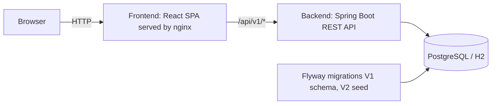

# Book Worm E-Bookstore

A full-stack e-bookstore built as a capstone project with **IBM Bob**. It has a Spring Boot REST backend, a PostgreSQL
database and a React UI. The UI follows the wireframes in `Slide-5.png` … `Slide-10.png`.

The app covers the whole customer journey: login, catalogue, product detail, cart, checkout with coupons and gift
points, simulated payment, confirmation, order history, "Buy it again", and cancelling an order within 48 hours.

## Contents
- [Repository layout](#repository-layout)
- [Running the application](#running-the-application)
- [Architecture](#architecture)
- [Infrastructure](#infrastructure)
- [Documentation](#documentation)
- [Testing](#testing)
- [How it was built with Bob](#how-it-was-built-with-bob)

## Repository layout

```
Capstone-project/
├── backend/             Spring Boot 3 (Java 17, Maven), see backend/README.md
├── frontend/            React 18 + Vite + Tailwind CSS, see frontend/README.md
├── docs/                backend-requirements.md, frontend-requirements.md, openapi.yaml, api-guide.md, testing.md, demo-script.md
├── scripts/             smoke-test.sh: end-to-end checks against a running server
├── docker-compose.yml   PostgreSQL + backend + frontend
├── redocly.yaml         OpenAPI lint rules for docs/openapi.yaml
├── PLAN.md              Original capstone plan and phases
└── recources/           Slide-5.png … Slide-10.png, the wireframes the UI and data model are based on
```

## Running the application

### Option 1: Docker (PostgreSQL, full stack)

Requires Docker with Compose.

```bash
docker compose up --build
```

| Service | URL | Notes |
|---|---|---|
| Frontend (nginx) | http://localhost:3000 | Proxies `/api/v1/` to the backend |
| Backend API | http://localhost:8080/api/v1 | Spring Boot |
| Health check | http://localhost:8080/api/v1/actuator/health | |
| PostgreSQL | internal to the Compose network (`db:5432`) | Database, user and password are all `bookworm`. Data is kept in the `pgdata` volume |

Flyway creates the schema and loads the seed data on first start.

To stop, run `docker compose down`. Add `-v` to also delete the database volume and start fresh.

To set your own JWT secret (at least 32 bytes), run `JWT_SECRET=<your-secret> docker compose up --build`.

### Option 2: Without Docker or PostgreSQL (in-memory H2)

Requires JDK 17+ and Maven. The `h2` profile uses an in-memory H2 database in PostgreSQL mode. Flyway still runs the
same migrations and seed data. Data is lost when the app stops, so use this for development only.

**Backend**

```bash
cd backend
mvn spring-boot:run -Dspring-boot.run.profiles=h2
```

The API is at http://localhost:8080/api/v1.

**Frontend** (Node 18+ or 22)

```bash
cd frontend
npm install
npm run dev
```

The UI is at http://localhost:5173. Vite proxies `/api/v1` to `localhost:8080`.

### Option 3: Local PostgreSQL, no Docker for the backend

Start PostgreSQL with a `bookworm` database and a `bookworm` user and password, then run `mvn spring-boot:run` in
`backend/`. Override the defaults with `DB_URL`, `DB_USER`, `DB_PASSWORD`, `PORT` and `JWT_SECRET`.

### Seed data and demo values
- 21 categories, 12 authors, 5 publishers and 30 books.
- Coupons: `WELCOME10` (10% off), `FLAT100` (₹100 off orders of ₹500 or more) and `EXPIRED20` (expired, used to test rejection).
- Register a new user through the UI or `POST /api/v1/auth/register`. The login modal also has a demo-credential filler.
- Payment is **simulated**. A card number ending in `0000` is declined, for example `4000000000020000`. Any other
  valid card, UPI id or wallet succeeds.

## Architecture



**Backend** (`com.bookworm`) is a layered Spring Boot application with base path `/api/v1`:

| Package | Responsibility |
|---|---|
| `web` | REST controllers: Auth, Catalogue, Cart, Address, Order, Review, Engagement (wishlist, writers, gift points) |
| `service` | Business logic: `PricingService`, `OrderService`, `CartService`, `PaymentSimulator`, `GiftPointService`, `RecommendationService`, `CatalogueService` and others |
| `repository` | Spring Data JPA repositories |
| `domain` | JPA entities (User, Book, Author, Publisher, Cart, Order, Payment, Coupon, GiftPointTxn and others) |
| `dto` | Request and response records |
| `config` | Spring Security with a JWT filter and service, and typed `AppProperties` |
| `exception` | `ApiException` and a global error handler that returns a consistent `ErrorResponse` |

Key design decisions:
- **Spec-first.** `docs/openapi.yaml` was written before the code, and the backend implements it.
- **Server-side pricing.** Subtotal, 12% tax, delivery, coupon and gift points are all computed on the server.
  The client never sends totals.
- **Stateless auth.** JWT with BCrypt password hashes. Cart, order, address, wishlist and review endpoints are scoped to the signed-in user.
- **Snapshots.** Orders store the delivery address and the unit prices as they were at purchase time.
- **Gift-points ledger.** Points are recorded in a transaction table. `users.gift_points` is only a cached balance.
- **Schema as code.** Hibernate runs with `ddl-auto: validate`, and Flyway owns the schema.
- **No sensitive payment data.** Card numbers and CVVs are never stored, only the last four digits.

**Frontend** is a React 18 SPA (Vite, Tailwind, React Router v6, Lucide icons) with context providers for auth, cart,
wishlist and toasts. Pages map to the wireframes: Home and Catalogue, Book detail, Checkout, Payment modal,
Confirmation, Orders, Wishlist and Writers. See [`frontend/README.md`](frontend/README.md).

## Infrastructure

| Component | Technology |
|---|---|
| Language and framework | Java 17, Spring Boot 3.3.5 (Web, Data JPA, Security, Validation, Actuator) |
| Build | Maven |
| Database | PostgreSQL 16 (Docker) or in-memory H2 (`h2` profile and tests) |
| Migrations | Flyway (`V1__schema.sql`, `V2__seed_data.sql`) |
| Auth | JWT (jjwt), tokens valid for 1 hour |
| Frontend build and serving | Node 22 build stage, nginx runtime |
| Containers | `backend/Dockerfile` (Maven build, then a JRE 17 image), `frontend/Dockerfile` (Node build, then nginx), `docker-compose.yml` |
| API linting | Redocly (`redocly.yaml`) |

Docker Compose runs three services: `db` (with a health check), `backend` (starts after the database is healthy) and
`frontend` (nginx, port 3000 mapped to 80).

Configuration is in `backend/src/main/resources/application.yml` and can be overridden with environment variables.
These include `PORT`, `DB_URL`, `DB_USER`, `DB_PASSWORD` and `JWT_SECRET`. Pricing rates, the cancel window and CORS
origins are set under the `bookworm.*` keys.

The Compose file is for local development. The default JWT secret and the `bookworm` database password must be
changed in any real deployment. Deploying to ROSA/ROKS was optional in the capstone and has not been done.

## Documentation

| Document | Content |
|---|---|
| [`PLAN.md`](PLAN.md) | Capstone requirements, assumptions, execution phases 0–12, risks and definition of done |
| [`docs/backend-requirements.md`](docs/backend-requirements.md) | Reverse-engineered functional and non-functional requirements, user stories, domain boundaries, backend modules and a journey-to-requirements traceability table |
| [`docs/frontend-requirements.md`](docs/frontend-requirements.md) | Wireframe analysis, features, ER diagram, PostgreSQL tables and business rules |
| [`docs/openapi.yaml`](docs/openapi.yaml) | OpenAPI 3.0.3 specification of the REST API |
| [`docs/api-guide.md`](docs/api-guide.md) | Readable API guide: every endpoint, worked request and response examples, pricing and business rules, validation rules per field, the error catalogue and the order state machine |
| [`docs/testing.md`](docs/testing.md) | Test strategy, what each test covers, requirement-to-test traceability, manual curl demo commands, latest results and known gaps |
| [`docs/demo-script.md`](docs/demo-script.md) | Outline and talking points for the demo video |
| [`backend/README.md`](backend/README.md) | Backend run options, behaviour notes and code layout |
| [`frontend/README.md`](frontend/README.md) | Wireframe-to-screen mapping, components and run instructions |

To lint the API spec: `npx @redocly/cli lint docs/openapi.yaml`.

## Testing

64 automated tests plus a 66-check smoke script. Latest run: **0 failures**. Details are in
[`docs/testing.md`](docs/testing.md).

| Layer | Tests | Run with |
|---|---|---|
| Unit: `PricingServiceTest`, `PaymentSimulatorTest`, `JwtServiceTest`, `MoneyTest` | 30 | `mvn test` |
| API integration: `ApiIntegrationTest` (journeys and business rules over real HTTP, H2) | 10 | `mvn test` |
| Validation and error handling: `ValidationAndErrorHandlingTest` | 24 | `mvn test` |
| Smoke script against a running server | 66 checks | `./scripts/smoke-test.sh` |

```bash
# Automated tests
cd backend
mvn test

# Smoke test: start the backend, then from the repo root (needs curl and jq)
cd backend && mvn spring-boot:run -Dspring-boot.run.profiles=h2
./scripts/smoke-test.sh            # add VERBOSE=1 to print every request and response
```

What is verified:
- **Journeys**: guest browsing, search, filter and sort; cart, coupon, gift points, payment (declined, then successful), cancel with refund, and reorder.
- **Validation**: every request field rule, malformed JSON, bad query parameters, bad enum values, Luhn and expiry checks on cards, UPI format, and coupon rules. Errors list each broken field in `fieldErrors`.
- **Error handling**: 400, 401, 404, 405 and 409 all use one JSON error shape, and no response contains a stack trace or exception name.
- **Security**: missing, garbage and forged tokens on 13 protected endpoints; users cannot read or change each other's orders, addresses or carts; passwords, card numbers and CVVs never appear in a response; a client cannot set its own price.
- **Business rules**: stock enforcement, the 48-hour cancel window, points reserved, redeemed and restored, tax and delivery maths.

## How it was built with Bob

The project was built **spec-first**, following the phases in [`PLAN.md`](PLAN.md), using IBM Bob in **Agent mode**.
Agent mode is Bob's mode for writing and changing code, running builds and tests, and reading files.

| Phase | What was done | Output |
|---|---|---|
| 0–1. Analyse | Bob read the wireframes (`Slide-5.png` … `Slide-10.png`). It listed screens, features and entities, and recorded wireframe inconsistencies and assumptions. | `docs/frontend-requirements.md` |
| Requirements | Requirements were reverse-engineered from the wireframes and the use-case slide. | `docs/backend-requirements.md` |
| 2. API spec | The OpenAPI spec was generated from the entities and journey, then reviewed and linted with Redocly. | `docs/openapi.yaml`, `redocly.yaml` |
| 3–5. Backend | Spring Boot code was generated from the spec. This covers entities, repositories, services, controllers, security and Flyway migrations with seed data, plus the business logic: pricing, points, simulated payment, 48-hour cancel, reorder and recommendations. | `backend/` |
| 6–8. Verify | The project was built and run. `ApiIntegrationTest` was written to check the journey and the business rules. | `ApiIntegrationTest`, `backend/target/surefire-reports` |
| 9. UI | The React screens were vibe-coded against the wireframes and wired to the API. | `frontend/` |
| 10. Deploy | Dockerfiles and a Compose file were added for running locally. | `docker-compose.yml`, both `Dockerfile`s |

Working rules followed throughout:
- Plan first, then implement. Make the smallest change that meets the requirement.
- Keep the spec, code and tests aligned. Build and test after each generation step.
- Record assumptions where the slides were ambiguous (PostgreSQL, Java 17, JWT, simulated payment, tax and points rules). They are listed in `PLAN.md` and `docs/frontend-requirements.md`.
- Review all generated code by hand.

After a review asked for more detail on the API design and on testing, Bob was used again to add
[`docs/api-guide.md`](docs/api-guide.md), the unit tests, `ValidationAndErrorHandlingTest` and `scripts/smoke-test.sh`.
It started the app, called the real endpoints to capture the examples in the guide, and ran the tests until they were green.
Two of the first failures were mistakes in the new tests, not in the application, and they were fixed in the tests.

The repository doesn't contain a custom Bob mode or a prompt log. The agent used was Bob's built-in Agent mode, and
the plan in `PLAN.md` served as its guide. `PLAN.md` also calls for `docs/prompt-log.md`, an Insomnia collection and
ICA-generated tests, and those are not in the repository yet.
