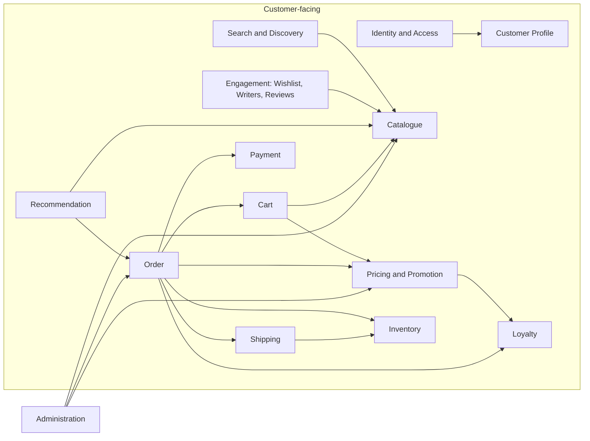

# Book Worm E-Bookstore — Backend Requirements (Reverse Engineered)

**Prompt 1 output: Analyze Wireframes and Create Requirements.**
No APIs are defined in this document. See Prompt 5 and Prompt 6 for the API design.

## 0. Source Evidence

| Source | What it shows |
|---|---|
| Slide 3 (use case) | 12-step customer journey: login, auth, category, brands, catalogue, product with tentative delivery date, related products, basket, recommendations, address, gift points, payment option, payment confirmation, purchase confirmation, cancel within 48 hrs, order history with "Buy it again". |
| Slide 4 (platform) | Landing page with book availability, selection of books, buy and commit payment. Technology workflow: PostgreSQL, Spring Boot, OpenAPI, ICA test agent, local or cloud deployment. **There is no separate architecture diagram.** The only architecture content is the technology and workflow list, so the module and domain boundaries below are derived from the journey and the screens. |
| Slide 5 (Home and Catalogue) | Top nav: *Book Worm, My Orders, My Wishlist, My Writers*, cart badge, profile icon. Left category rail with 20 categories. Search box. Filters for Language, Format, Price range and Sort by. Shelves: *Recommended for You*, *Bestsellers this Month*, *New Launches*. Book card: cover, title, author link, blurb, format, genre tags, price (₹), "Delivery by <date>". |
| Slide 6 (Product detail) | Breadcrumb. Front and back cover images. Title, author, description, publisher link, format, genre tags, price, delivery date. *Add to Cart* and *Add to Wishlist*. Language, average rating, "145 copies sold". *About the writer* (photo and bio). *Reviews* (star rating plus text limited to 100 characters, submit, list of reviews). *Related Reads*. |
| Slide 7 (Checkout) | Cart lines with quantity stepper. Address form (*Use Saved Address*, first name, last name, address, e-mail, city, PIN, phone with country code, state, country). Grand total: price (n items), tax, delivery charges, *Apply Coupon*, discount, total amount, *Pay Now*. |
| Slide 8 (Payment) | *Complete Payment* with payable amount. Methods: Credit Card, Debit card, UPI, Wallet. Card fields: number, name on card, CVV, expiry (MM/YYYY). |
| Slide 9 (Confirmation) | "Your purchase of the following reads is successful", purchased books with price and delivery date, *Continue your Shopping*. |

**Observations and inconsistencies in the wireframes**
- The checkout total is ₹508 + ₹62 tax − ₹100 discount = ₹470, but the payment screen shows ₹580. The payable amount must always be server-computed, never trusted from the client.
- Gift-point redemption and 48-hour cancellation appear only in the Slide 3 journey. They have no wireframe screen.
- *My Writers* appears in the nav, but no wireframe shows it. It is interpreted as "followed or favourite authors".
- UPI and Wallet are shown as payment options, but Slide 8 only wires up card fields.
- Slide 6 shows a "Home / Non-Fiction / Self Help" breadcrumb. Categories are therefore hierarchical (Non-Fiction → Self Help), while the left rail shows a flat genre list.

---

## 1. Functional Requirements

### 1.1 Identity and Access
| ID | Requirement |
|---|---|
| FR-AUTH-01 | A visitor can register with name, e-mail and password. |
| FR-AUTH-02 | A registered user can log in and receive a stateless token (JWT). |
| FR-AUTH-03 | A user can log out, and tokens expire. |
| FR-AUTH-04 | Guests can browse the catalogue, search and view product details without logging in. |
| FR-AUTH-05 | Cart persistence, checkout, wishlist, reviews, orders and profile require authentication. |
| FR-AUTH-06 | Roles are GUEST (anonymous), CUSTOMER and ADMIN. Authorization is role-based. |

### 1.2 User Profile and Address Book
| ID | Requirement |
|---|---|
| FR-USR-01 | A user can view and update their profile (name, phone with country code). |
| FR-USR-02 | A user can save, list, update, delete and default-flag multiple delivery addresses (first name, last name, address lines, city, state, PIN, country, phone, e-mail). |
| FR-USR-03 | Checkout can use a saved address ("Use Saved Address") or a one-off address. |
| FR-USR-04 | A user can view their gift-point balance and its transaction history. |

### 1.3 Catalogue
| ID | Requirement |
|---|---|
| FR-CAT-01 | The system lists categories (genres): Romance, Mystery, Science Fiction, Fantasy, Historical, Biography, Self-help, Memoir, Travel, Cooking, Children's, Young Adult, Comics & Graphic Novels, Poetry, Drama, Science, Philosophy, Religion, Language Learning. It also supports a parent/child hierarchy (Non-Fiction → Self Help) and an "All" view. |
| FR-CAT-02 | Books can be listed by category, with pagination. |
| FR-CAT-03 | A book has: title, description, cover image (front and back), format (Paperback, Hard Cover, eBook), language, price (₹), ISBN, author(s), publisher, genre tags, average rating, copies sold and stock status. |
| FR-CAT-04 | "Browse the brands" is mapped to browsing by **publisher** and **author** (see Assumptions). |
| FR-CAT-05 | A book detail view shows the book, its author bio and photo ("About the writer"), its publisher, reviews and related reads. |
| FR-CAT-06 | The home page exposes curated shelves: *Recommended for You* (personalised), *Bestsellers this Month* and *New Launches*. |
| FR-CAT-07 | Related books ("Related Reads") are returned for a given book (same category or author, or co-purchase). |
| FR-CAT-08 | Every listed book carries a **tentative delivery date** ("Delivery by Mon, 21 Jul"), computed from the current date, stock and delivery rules. |
| FR-CAT-09 | An author page and an author list are available (*My Writers*). |
| FR-CAT-10 | An ADMIN can create, update, deactivate and (soft) delete books, authors, publishers and categories, and manage stock and prices. |

### 1.4 Search, Filter and Sort
| ID | Requirement |
|---|---|
| FR-SRCH-01 | Free-text search over title, author, ISBN, publisher and tags. |
| FR-SRCH-02 | Filters: category, language, format, price range, author, publisher and minimum rating. |
| FR-SRCH-03 | Sort: relevance (default), price ascending/descending, rating, newest, bestselling. |
| FR-SRCH-04 | Search, filter and sort are combinable and paginated. |

### 1.5 Wishlist and Followed Writers
| ID | Requirement |
|---|---|
| FR-WSH-01 | A customer can add and remove books to and from their wishlist ("Add to Wishlist"). |
| FR-WSH-02 | A customer can list their wishlist (*My Wishlist*) and move an item to the cart. |
| FR-WSH-03 | A customer can follow or unfollow authors and list followed authors (*My Writers*). |

### 1.6 Cart
| ID | Requirement |
|---|---|
| FR-CRT-01 | A customer can add a book to the cart ("Add to Cart"). The cart count badge is shown in the nav. |
| FR-CRT-02 | A customer can change the quantity (stepper +/−) and remove a line. |
| FR-CRT-03 | The cart returns a price summary: items subtotal ("Price (n items)"), tax, delivery charges (can be "Free"), coupon discount, gift-point discount and total. |
| FR-CRT-04 | A coupon code can be applied to and removed from the cart. Invalid, expired and ineligible coupons are rejected with a reason. |
| FR-CRT-05 | The cart is persisted per user, and guest cart items are merged on login (assumption). |
| FR-CRT-06 | Cart lines are re-validated for price and stock on every read and at checkout. |
| FR-CRT-07 | Recommendations based on order history are shown alongside the cart. |

### 1.7 Checkout and Order
| ID | Requirement |
|---|---|
| FR-ORD-01 | A customer converts the cart into an order by supplying a delivery address (saved or new). |
| FR-ORD-02 | A customer can optionally redeem gift points against the order. Redemption is limited to the available balance and a maximum percentage of the order. |
| FR-ORD-03 | The order snapshots the item title, price, tax, discount and address at purchase time. |
| FR-ORD-04 | Stock is reserved at order placement. It is released on payment failure, expiry or cancellation. |
| FR-ORD-05 | Order statuses cover at least: PENDING_PAYMENT, PAID, PROCESSING, SHIPPED, DELIVERED, CANCELLED and PAYMENT_FAILED. |
| FR-ORD-06 | A customer can view their order history (*My Orders*) with filters and pagination, and view order details. |
| FR-ORD-07 | **Buy it again:** from a past order or item, the customer can add the same items to the cart, re-priced at current prices and stock. |
| FR-ORD-08 | A customer can cancel an order **within 48 hours** of placement, provided it has not shipped. Cancellation releases stock, triggers a refund and restores redeemed points. |
| FR-ORD-09 | Order confirmation returns the purchased items with price and delivery date, and an order number. |
| FR-ORD-10 | An ADMIN can view all orders and update fulfilment status. |

### 1.8 Payment
| ID | Requirement |
|---|---|
| FR-PAY-01 | Supported methods: Credit Card, Debit Card, UPI, Wallet. |
| FR-PAY-02 | Card payment inputs: card number, name on card, CVV, expiry (MM/YYYY). They are validated (Luhn, expiry in the future, CVV length). |
| FR-PAY-03 | The payable amount is calculated server-side from the order. A client-sent amount is never trusted. |
| FR-PAY-04 | A payment attempt results in SUCCESS or FAILED, and is idempotent (the same attempt cannot double-charge). |
| FR-PAY-05 | On success the order moves to PAID. On failure the customer can retry or choose another method. |
| FR-PAY-06 | Payment is **simulated** through a gateway adapter with no real PSP (see Assumptions). Full card numbers and CVV are never stored. |
| FR-PAY-07 | Refunds are recorded for cancelled orders. |

### 1.9 Shipping and Delivery
| ID | Requirement |
|---|---|
| FR-SHP-01 | The system computes the tentative delivery date shown on listings, the cart and the confirmation. |
| FR-SHP-02 | The system computes delivery charges (for example free above a threshold). |
| FR-SHP-03 | A shipment is created for a paid order, with a status lifecycle (PREPARING, SHIPPED, IN_TRANSIT, DELIVERED) and a tracking reference. |
| FR-SHP-04 | A customer can see shipment status on an order. |

### 1.10 Reviews and Ratings
| ID | Requirement |
|---|---|
| FR-REV-01 | A customer can submit a review (1–5 stars and text of up to 100 characters, per the "0/100" counter). |
| FR-REV-02 | Reviews are listed per book, with reviewer name, text and stars. |
| FR-REV-03 | The book's average rating and review count are derived from its reviews. |
| FR-REV-04 | One review per customer per book. Reviews are limited to verified purchasers (assumption, configurable). |
| FR-REV-05 | An ADMIN can moderate (hide or delete) reviews. |

### 1.11 Coupons and Gift Points
| ID | Requirement |
|---|---|
| FR-CPN-01 | Coupons have a code, discount type (percent or fixed), value, validity window, minimum order value, usage limits and an active flag. |
| FR-CPN-02 | Coupon validation and discount calculation are done server-side. |
| FR-CPN-03 | An ADMIN can create, update and deactivate coupons. |
| FR-GFT-01 | Gift points are earned on completed purchases (rule is configurable). |
| FR-GFT-02 | Points can be redeemed at checkout for a monetary discount at a configured rate. |
| FR-GFT-03 | Every change to points is recorded in a ledger (earn, redeem, restore, expire). |

### 1.12 Recommendations
| ID | Requirement |
|---|---|
| FR-REC-01 | *Recommended for You* is derived from the user's order history (categories and authors previously bought, excluding already purchased books). |
| FR-REC-02 | Anonymous users and users with no history fall back to bestsellers. |
| FR-REC-03 | *Bestsellers this Month* is derived from sales in the current month. *New Launches* is derived from publication or creation date. |
| FR-REC-04 | *Related Reads* is derived from catalogue relationships (see FR-CAT-07). |

### 1.13 Administration
| ID | Requirement |
|---|---|
| FR-ADM-01 | An ADMIN can manage the catalogue, stock, coupons, review moderation and order status. |
| FR-ADM-02 | An ADMIN can list users and deactivate a user (assumption). |

---

## 2. Non-Functional Requirements

| ID | Category | Requirement |
|---|---|---|
| NFR-01 | Security | JWT bearer authentication. Passwords hashed with BCrypt or Argon2. RBAC enforced per endpoint. |
| NFR-02 | Security | PCI-aware design. Card data (PAN, CVV) is never persisted or logged. Only a masked reference (last 4 digits and brand) is kept. |
| NFR-03 | Security | OWASP Top 10 mitigations: input validation, parameterised queries, CORS allow-list, rate limiting on login and coupon endpoints, secure headers. |
| NFR-04 | Security | Object-level authorization: a user can only access their own cart, orders, addresses, wishlist and points. |
| NFR-05 | Performance | Catalogue and search: p95 < 300 ms at 100 concurrent users. Checkout and payment: p95 < 1 s (simulated gateway). |
| NFR-06 | Scalability | Stateless application tier that scales horizontally. Pagination on all list resources. Indexes on search and filter columns. |
| NFR-07 | Availability | Target 99.5% for the capstone and local deployment. Health and readiness endpoints. |
| NFR-08 | Data integrity | ACID transactions across order, stock, payment and points. Optimistic locking on stock, cart and order. Idempotent payment. |
| NFR-09 | Data integrity | UUID primary keys, audit columns (created_at, created_by, updated_at, updated_by), soft delete (is_deleted) and a version column. |
| NFR-10 | Consistency | Money is stored with fixed precision (NUMERIC(12,2)) in a single currency (INR). Rounding is defined once. |
| NFR-11 | Observability | Structured logs with a correlation ID. Metrics and tracing hooks. No PII or card data in logs. |
| NFR-12 | API quality | Contract-first OpenAPI 3.1. Consistent error format (RFC 7807 Problem Details). Versioned URIs. |
| NFR-13 | Maintainability | Modular monolith with clear package boundaries. At least 80% unit-test coverage. Integration tests on Testcontainers PostgreSQL. |
| NFR-14 | Portability | Runs locally via Docker Compose (app + PostgreSQL). Flyway-managed schema. Cloud-ready (config via environment variables). |
| NFR-15 | Usability | Responses carry what the UI needs (for example delivery date, cart count, derived totals) to avoid chatty clients. |
| NFR-16 | Localisation | Currency is ₹ (INR). Dates are ISO-8601 in UTC, with display formatting done by the UI. Phone numbers carry a country code. |
| NFR-17 | Privacy | PII (e-mail, phone, address) is minimised, and soft-deleted users are anonymisable on request. |
| NFR-18 | Resilience | The payment gateway adapter has timeouts and failure handling. An order stuck in PENDING_PAYMENT expires and releases stock. |

---

## 3. User Roles

| Role | Description | Capabilities |
|---|---|---|
| **GUEST** | Anonymous visitor | Browse home shelves, categories, authors and publishers. Search and filter. View product details and reviews. Register and log in. |
| **CUSTOMER** | Authenticated shopper | Everything a guest can do, plus: manage profile and addresses, wishlist, followed writers, cart, coupons, gift points, checkout, payment, order history, buy-it-again, cancel within 48 hrs, write reviews, personalised recommendations. |
| **ADMIN** | Store operator | Manage catalogue (books, authors, publishers, categories), stock and prices, coupons, review moderation, all orders and shipment status, and users. |
| **System / Payment Gateway (non-human)** | Internal actors | Simulated PSP, scheduled jobs (order expiry, points expiry, bestseller refresh). |

---

## 4. User Stories

Format: *As a ‹role›, I want ‹goal›, so that ‹benefit›.* Acceptance criteria are summarised after each group.

### Authentication and profile
- **US-01** As a visitor, I want to register, so that I can buy books.
- **US-02** As a customer, I want to log in and log out securely, so that my data is protected.
- **US-03** As a customer, I want to save several addresses and pick one at checkout, so that I do not retype it ("Use Saved Address").
- **US-04** As a customer, I want to see my gift-point balance, so that I know what I can redeem.

### Discovery
- **US-05** As a guest, I want to browse books by category, so that I can find what I like.
- **US-06** As a guest, I want to browse by author and publisher, so that I can find more from those I trust.
- **US-07** As a guest, I want to search by keyword, so that I can find a specific book quickly.
- **US-08** As a guest, I want to filter by language, format and price range and sort the results, so that I can narrow the choices.
- **US-09** As a visitor, I want to see Bestsellers and New Launches on the landing page, so that I can discover popular and new books.
- **US-10** As a customer, I want a "Recommended for You" shelf based on what I bought before, so that discovery is relevant.
- **US-11** As a guest, I want to see each book's tentative delivery date, so that I can decide before buying.
- **US-12** As a guest, I want to see a book's description, author bio, publisher, rating, copies sold and reviews, so that I can judge it.
- **US-13** As a guest, I want to see related reads on a book page, so that I can explore similar titles.

### Engagement
- **US-14** As a customer, I want to add or remove a book from my wishlist, so that I can buy it later.
- **US-15** As a customer, I want to follow authors and see them under *My Writers*, so that I can track their books.
- **US-16** As a customer, I want to rate and review a book (up to 100 characters), so that I can share my opinion.

### Cart and checkout
- **US-17** As a customer, I want to add books to my cart, so that I can buy several at once.
- **US-18** As a customer, I want to change quantities or remove items, so that I control my order.
- **US-19** As a customer, I want to see price, tax, delivery charge, discount and total, so that I know what I will pay.
- **US-20** As a customer, I want to apply a coupon, so that I get a discount.
- **US-21** As a customer, I want to redeem gift points, so that I use my rewards.
- **US-22** As a customer, I want to pick a delivery address, so that the books reach me.
- **US-23** As a customer, I want to choose a payment method (credit card, debit card, UPI, wallet), so that I can pay my way.
- **US-24** As a customer, I want to enter payment details and pay, so that my order is confirmed.
- **US-25** As a customer, I want a confirmation of my purchase with the items and delivery dates, so that I know it worked.

### Orders
- **US-26** As a customer, I want to see my order history, so that I can track my purchases.
- **US-27** As a customer, I want to "Buy it again" from a past order, so that I can reorder quickly.
- **US-28** As a customer, I want to cancel an order within 48 hours, so that I can change my mind.
- **US-29** As a customer, I want to track shipment status, so that I know when it arrives.

### Administration
- **US-30** As an admin, I want to create and edit books, authors, publishers and categories, so that the catalogue stays current.
- **US-31** As an admin, I want to manage stock and prices, so that availability and pricing are accurate.
- **US-32** As an admin, I want to create and deactivate coupons, so that I can run promotions.
- **US-33** As an admin, I want to moderate reviews, so that abusive content is removed.
- **US-34** As an admin, I want to see all orders and update their fulfilment status, so that I can run operations.

### Key acceptance criteria (samples)
| Story | Acceptance criteria |
|---|---|
| US-11 | Every book in a list or detail response has a delivery date. The date is never in the past. Out-of-stock books show no date. |
| US-19 | Total = items subtotal + tax + delivery − coupon discount − points discount. It is never negative and is recalculated server-side. |
| US-20 | An expired, inactive, below-minimum or exhausted coupon is rejected with a specific reason. Only one coupon per cart (assumption). |
| US-24 | A failed payment leaves the order unpaid and stock reserved for a limited time. A retry never causes a double charge. |
| US-27 | Unavailable books are reported rather than silently dropped. Prices are the current prices. |
| US-28 | Allowed only when now − order time ≤ 48 h and the order is not SHIPPED or DELIVERED. Otherwise rejected with a clear reason. A refund and point restoration follow. |

---

## 5. Business Capabilities

| # | Capability | Description | Level |
|---|---|---|---|
| BC-1 | Customer Identity and Access Management | Registration, authentication, authorization, roles | Core support |
| BC-2 | Customer Profile and Address Management | Profile, address book | Supporting |
| BC-3 | Catalogue Management | Books, categories, authors, publishers, media, stock status | Core |
| BC-4 | Product Discovery | Search, filter, sort, browse, shelves | Core |
| BC-5 | Personalisation and Recommendation | History-based and related-product recommendations | Differentiating |
| BC-6 | Customer Engagement | Wishlist, followed writers, reviews and ratings | Supporting |
| BC-7 | Shopping Cart Management | Basket, quantities, price summary | Core |
| BC-8 | Pricing, Tax and Promotion | Tax, delivery charge, coupons, discounts | Core |
| BC-9 | Loyalty Management | Gift-point earn, redeem, ledger | Supporting |
| BC-10 | Order Management | Checkout, order lifecycle, history, reorder, cancellation | Core |
| BC-11 | Inventory Management | Stock tracking, reservation, release | Core |
| BC-12 | Payment Processing | Method selection, authorisation, refunds | Core |
| BC-13 | Fulfilment and Delivery | Delivery estimation, shipment, tracking | Core |
| BC-14 | Store Administration | Back-office operations and moderation | Supporting |
| BC-15 | Platform Operations | Health, logging, configuration, audit | Generic |

---

## 6. Domain Boundaries

The system is a **modular monolith**, with one deployable and strict module boundaries (candidates for later extraction).

| Domain | Type | Owns (language) | Boundary rule |
|---|---|---|---|
| Identity and Access | Generic | Account, credentials, role, token | Only module that reads credentials. Others reference `userId`. |
| Customer Profile | Supporting | Profile, address book | Addresses are copied (snapshotted) into orders. Orders never point to the live address as the source of truth. |
| Catalogue | Core | Book, Author, Publisher, Category, media | Source of truth for book data. Does not know about carts or orders. Rating is a read-only projection from Reviews. |
| Search and Discovery | Core | Search index or queries, filters, shelves | Read-only over Catalogue, Sales stats and Reviews. |
| Engagement | Supporting | Wishlist, followed writers, Review | References books and users by ID. Review writes are gated on purchase history from Orders. |
| Recommendation | Differentiating | Recommendation read models | Read-only from Orders and Catalogue. Owns no transactional data. |
| Cart | Core | Cart, cart line | Holds only references and quantities. Prices are computed by Pricing at read time. |
| Pricing and Promotion | Core | Coupon, tax rule, delivery charge rule, price quote | Pure calculation plus coupon data. Returns a **quote** that Order snapshots. |
| Loyalty | Supporting | Points account, points ledger | Only way to change point balance. Invoked by Order. |
| Order | Core | Order, order line, status history, order address snapshot | Orchestrates checkout (a saga). Owns the order lifecycle and the 48-hour rule. |
| Inventory | Core | Stock level, reservation | Only module that changes stock. Order requests reserve and release. |
| Payment | Core | Payment, payment attempt, refund | Order does not see card data. Payment reports a result to Order. |
| Shipping | Core | Shipment, tracking events, delivery estimate | Delivery estimation is a service used by Catalogue views, Cart and Order. |
| Administration | Supporting | No data of its own | A façade with admin-only authorisation over other modules' application services. |

**Cross-domain rules**
- Modules talk through application services or domain events and never through each other's tables.
- Checkout is the main transaction boundary: Cart → Pricing quote → Inventory reserve → Loyalty redeem → Order create → Payment → Order confirm or compensate.
- Money values are snapshotted into the order at placement.

---

## 7. Backend Modules

| Module (package) | Responsibilities | Depends on |
|---|---|---|
| `identity` | Registration, login, JWT issue and validation, roles, password hashing | `customer` (profile creation) |
| `customer` | Profile, address book | `identity` |
| `catalog` | Books, authors, publishers, categories, media, admin CRUD | none |
| `search` | Query, filter and sort over catalogue, shelves (bestsellers, new launches) | `catalog`, `order` (sales stats), `review` (ratings) |
| `wishlist` | Wishlist and followed writers | `catalog`, `identity` |
| `review` | Reviews, rating aggregation, moderation | `catalog`, `order` (purchase check) |
| `recommendation` | Personalised, related and fallback recommendations | `order`, `catalog` |
| `cart` | Cart lifecycle, lines, merge on login | `catalog`, `pricing` |
| `pricing` | Tax, delivery charge, coupon validation, quote, coupon admin | `loyalty`, `shipping` |
| `loyalty` | Gift-point accounts, ledger, earn and redeem rules | none |
| `inventory` | Stock levels, reservations, release | `catalog` |
| `order` | Checkout orchestration, order lifecycle, history, reorder, 48-hr cancellation | `cart`, `pricing`, `inventory`, `loyalty`, `payment`, `customer` |
| `payment` | Payment methods, simulated gateway adapter, attempts, refunds | `order` (via events or callbacks) |
| `shipping` | Delivery date estimation, shipment, tracking | `inventory`, `order` |
| `admin` | Admin-only façade and back-office use cases | all |
| `common` / `platform` | Error model (Problem Details), audit base entity, pagination, security config, clock, ID generation, observability | none |
| `scheduler` (within platform) | Order expiry, reservation release, bestseller refresh | `order`, `inventory`, `search` |

**Layering in each module:** `api` (controllers, DTOs) → `application` (services, use cases) → `domain` (entities, rules) → `infrastructure` (repositories, adapters).

---

## 8. API Domains

Domains only. Resources, endpoints and DTOs are deferred to Prompt 5.

| # | API Domain | Primary actors | Auth | Backed by module |
|---|---|---|---|---|
| 1 | Authentication | Guest | Public | `identity` |
| 2 | Users (profile, addresses, points) | Customer | JWT | `customer`, `loyalty` |
| 3 | Authors (and followed writers) | Guest, Customer, Admin | Public read, JWT write | `catalog`, `wishlist` |
| 4 | Publishers | Guest, Admin | Public read, Admin write | `catalog` |
| 5 | Categories | Guest, Admin | Public read, Admin write | `catalog` |
| 6 | Books (detail, related, shelves) | Guest, Admin | Public read, Admin write | `catalog`, `search` |
| 7 | Search (query, filter, sort) | Guest | Public | `search` |
| 8 | Wishlist | Customer | JWT | `wishlist` |
| 9 | Cart (with coupon, price summary) | Customer | JWT | `cart`, `pricing` |
| 10 | Orders (checkout, history, reorder, cancel) | Customer, Admin | JWT | `order` |
| 11 | Payments | Customer, Admin | JWT | `payment` |
| 12 | Shipping (estimate, tracking) | Guest, Customer, Admin | Public estimate, JWT tracking | `shipping` |
| 13 | Reviews | Guest read, Customer write, Admin moderate | Mixed | `review` |
| 14 | Coupons | Admin (customers only via cart) | Admin | `pricing` |
| 15 | Recommendations | Guest, Customer | Public or JWT | `recommendation` |

Cross-cutting: error model (Problem Details), pagination, sorting and filtering conventions, and health endpoints.

---

## 9. Data Ownership Matrix

**W** = sole writer (owner). **R** = read-only access, through the owner's service. **—** = no access. A "ref" means it holds only the owner's ID.

| Data entity | identity | customer | catalog | search | wishlist | review | recomm. | cart | pricing | loyalty | inventory | order | payment | shipping | admin |
|---|---|---|---|---|---|---|---|---|---|---|---|---|---|---|---|
| User account and credentials | **W** | R | — | — | ref | ref | ref | ref | — | ref | — | ref | — | — | R |
| Role | **W** | — | — | — | — | — | — | — | — | — | — | — | — | — | R |
| Profile | — | **W** | — | — | — | R (name) | — | — | — | — | — | — | — | — | R |
| Saved address | — | **W** | — | — | — | — | — | — | — | — | — | R (snapshot source) | — | R | — |
| Book | — | — | **W** | R | R | R | R | R | R | — | R | R (snapshot) | — | — | W via catalog |
| Author | — | — | **W** | R | R | — | R | — | — | — | — | — | — | — | W via catalog |
| Publisher | — | — | **W** | R | — | — | — | — | — | — | — | — | — | — | W via catalog |
| Category | — | — | **W** | R | — | — | R | — | — | — | — | — | — | — | W via catalog |
| Book media (covers) | — | — | **W** | R | — | — | — | — | — | — | — | — | — | — | W via catalog |
| Related-book link | — | — | **W** | R | — | — | R | — | — | — | — | — | — | — | W via catalog |
| Stock level and reservation | — | — | R (availability) | R | — | — | — | R | — | — | **W** | R | — | R | W via inventory |
| Wishlist item | — | — | — | — | **W** | — | R | — | — | — | — | — | — | — | — |
| Followed writer | — | — | — | — | **W** | — | R | — | — | — | — | — | — | — | — |
| Review | — | — | R (rating) | R | — | **W** | R | — | — | — | — | R | — | — | W (moderation) |
| Rating aggregate | — | — | R | R | — | **W** | R | — | — | — | — | — | — | — | — |
| Cart and cart line | — | — | — | — | — | — | — | **W** | R | — | — | R (at checkout) | — | — | — |
| Coupon | — | — | — | — | — | — | — | R | **W** | — | — | R | — | — | W via pricing |
| Tax and delivery-charge rule | — | — | — | — | — | — | — | R | **W** | — | — | R | — | R | W via pricing |
| Price quote | — | — | — | — | — | — | — | R | **W** (transient) | — | — | R (snapshot) | — | — | — |
| Gift-point account and ledger | — | — | — | — | — | — | — | — | R | **W** | — | R | — | — | R |
| Order and order line | — | — | — | R (sales) | — | R (verified purchase) | R | — | — | — | — | **W** | R | R | R, status via order |
| Order address snapshot | — | — | — | — | — | — | — | — | — | — | — | **W** | — | R | R |
| Order status history | — | — | — | — | — | — | — | — | — | — | — | **W** | — | R | R |
| Payment and attempt | — | — | — | — | — | — | — | — | — | — | — | R (result) | **W** | — | R |
| Refund | — | — | — | — | — | — | — | — | — | R (restore) | — | R | **W** | — | R |
| Shipment and tracking event | — | — | — | — | — | — | — | — | — | — | — | R | — | **W** | W via shipping |
| Delivery estimate (derived) | — | — | R | R | — | — | — | R | — | — | R | R | — | **W** | — |
| Sales and bestseller stats (derived) | — | — | — | **W** (read model) | — | — | R | — | — | — | — | R | — | — | R |
| Recommendation read model | — | — | — | — | — | — | **W** | — | — | — | — | — | — | — | — |
| Audit log | platform | platform | platform | platform | platform | platform | platform | platform | platform | platform | platform | platform | platform | platform | R |

---

## 10. Assumptions

| # | Assumption | Basis |
|---|---|---|
| A-01 | There is no separate architecture diagram in the pack. Domain and module boundaries are derived from the 12-step journey, the six screens and the technology slide. | Slides 3–4 |
| A-02 | "Brands" is interpreted as **publishers and authors** for a book store. | Slide 3 ("browse the brands"), Slide 6 ("Published by ABC Publishers") |
| A-03 | Categories are hierarchical (Non-Fiction → Self Help) and the left rail shows the genre list. A book may have several category tags. | Slide 5, Slide 6 breadcrumb |
| A-04 | "My Writers" means followed or favourite authors. | Nav bar, no screen |
| A-05 | Currency is INR (₹). Prices are tax-exclusive, and tax is added in the grand total. The tax rate is configurable. | Slide 7 |
| A-06 | Delivery charge is "Free" above a configurable threshold. Otherwise a flat rate applies. | Slide 7 |
| A-07 | The tentative delivery date = order date + processing days + transit days, based on the PIN code when known. A default is used when no address is known. eBooks may be delivered instantly. | Slides 5–9 |
| A-08 | Gift points: 1 point = a configurable currency value, earned at a configurable % of the paid amount. They are redeemable up to a cap per order. | Slide 3 only |
| A-09 | A coupon is applied to a cart. One coupon per order. | Slide 7 |
| A-10 | Payment is **simulated**: a fake gateway adapter returns success or failure deterministically (for example by test card number). UPI and Wallet are modelled as methods with simulated flows. | Slide 4, PLAN.md |
| A-11 | The payable amount from the server is authoritative. The ₹580 on Slide 8 and the ₹470 on Slide 7 are sample data. | Slides 7–8 |
| A-12 | The 48-hour cancellation window starts at order placement (payment confirmation) and applies only before shipment. | Slide 3 |
| A-13 | Reviews are limited to 100 characters (from the "0/100" counter), with a 1–5 star rating. Verified-purchase gating is configurable and defaults to on. | Slide 6 |
| A-14 | "Sells: 145 copies sold" is derived from paid order lines. | Slide 6 |
| A-15 | A book has one format per record (Paperback, Hard Cover, eBook). The same title in another format is a separate SKU linked by a work or ISBN group. | Slide 5 |
| A-16 | Stock is tracked for physical formats and is unlimited for eBooks. | Slide 5 |
| A-17 | Guest carts are client-side or held for a short time, and merged on login. | Journey (login first) |
| A-18 | Tech stack follows the prompt pack: Java 21, Spring Boot 3.x, Maven, PostgreSQL, Spring Security JWT, JPA, Flyway, MapStruct, Lombok, Testcontainers. (`PLAN.md` mentions Java 17+. Java 21 is used because the prompt pack states it.) | Prompt 8 |
| A-19 | A modular monolith is a better fit than microservices for a capstone, with boundaries that could later be split. | Slide 4 |
| A-20 | A single country and single currency for the first release. The address form defaults to India but stores a country field. | Slide 7 |
| A-21 | Order data is retained for the long term. User data is soft-deleted. | NFR-09 |

---

## 11. Out of Scope Items

| # | Item | Reason |
|---|---|---|
| OS-01 | Real payment gateway integration (PCI-compliant PSP, 3-D Secure, real UPI or wallet providers) | Payment is simulated |
| OS-02 | Real courier or logistics integration, label printing, returns and RMA | Tracking is modelled only |
| OS-03 | Product returns and replacements, beyond the 48-hour cancellation | Not in the journey |
| OS-04 | eBook reading, DRM and downloads | Only the eBook format is listed |
| OS-05 | UI implementation of the screens (a separate deliverable) | This document is backend only |
| OS-06 | E-mail, SMS and push notifications (order confirmation mails and so on) | Not shown in the wireframes. Domain events leave room for it later. |
| OS-07 | Social login, MFA, password reset by e-mail | Not shown in the wireframes |
| OS-08 | Multi-currency, multi-language content, multi-warehouse inventory and tax jurisdictions | Single-store assumption |
| OS-09 | Marketplace and seller onboarding (multi-vendor) | Single retailer |
| OS-10 | ML-based recommendation engine | Rule-based recommendations are enough |
| OS-11 | External search engine (Elasticsearch and similar) | PostgreSQL queries are enough at this scale |
| OS-12 | Analytics dashboards and reporting | Not in the wireframes |
| OS-13 | Gift cards, subscriptions, pre-orders, bundles | Not in the wireframes |
| OS-14 | Cloud provisioning (AWS, ROSA, ROKS), CI/CD and production hardening | Later prompts (19–23) and optional |
| OS-15 | Customer support, chat and complaints handling | Not shown |
| OS-16 | Invoice and GST document generation | Not shown |

---

## Traceability: Journey Step → Requirements

| Slide 3 step | Requirements |
|---|---|
| 1–2 Login and authentication | FR-AUTH-01…06 |
| 3 Select category, access catalogue | FR-CAT-01, 02, 06; FR-SRCH-01…04 |
| 4 Browse brands | FR-CAT-04, 09 |
| 5 Select product (with tentative delivery date) | FR-CAT-03, 05, 08 |
| 6 Related products | FR-CAT-07, FR-REC-04 |
| 7 Add to basket | FR-CRT-01…06 |
| 8 Recommendations from order history | FR-REC-01…03, FR-CRT-07 |
| 9 Select delivery address | FR-USR-02, 03; FR-ORD-01 |
| 10 Redeem gift points | FR-GFT-01…03; FR-ORD-02 |
| 11 Initiate payment and confirm | FR-PAY-01…07 |
| 12 Confirmation | FR-ORD-09 |
| Cancel within 48 hrs | FR-ORD-08 |
| Order history and Buy it again | FR-ORD-06, 07 |
| Wireframe extras: wishlist, reviews, coupon, writers | FR-WSH-01…03; FR-REV-01…05; FR-CPN-01…03 |
