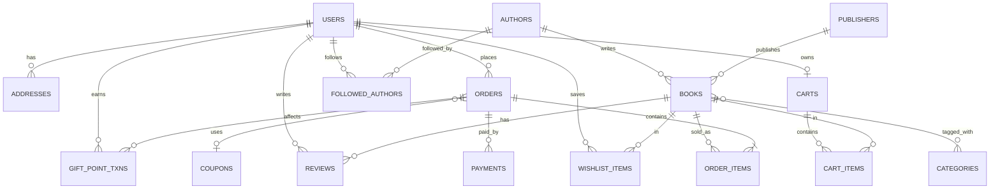

# Phase 1: Wireframe Analysis, Features and Data Model

Source: slides 5–10 (`Slide-5.png` … `Slide-10.png`) of the capstone deck. The app is branded **"Book Worm"**, uses a dark theme, and shows prices in ₹ (INR).

## 1. Screen-by-screen analysis

| Slide | Screen | What the wireframe shows |
|---|---|---|
| 5 | Landing | Top nav (My Orders, My Wishlist, My Writers, cart badge, profile). Category sidebar, search, filters, and the sections "Recommended for You", "Bestsellers this Month" and "New Launches". |
| 6 | Catalogue | Same layout as the landing page. Filters: **Search**, **Language**, **Format** (Paperback/eBook/Hardcover), **Price Range**, **Sort by** (Relevance, …). The sidebar has 19 categories (Romance, Mystery, Science Fiction, Fantasy, Historical, Biography, Self-help, Memoir, Travel, Cooking, Children's, Young Adult, Comics & Graphic Novels, Poetry, Drama, Science, Philosophy, Religion, Language Learning). Each card shows cover, title, author link, blurb, format, genre tags, price and "Delivery by <date>". |
| 7 | Product detail | Breadcrumb (Home / Non-Fiction / Self Help). Front and back cover, title, author, short description, **publisher**, format, genre tags, price, delivery date, **Add to Cart**, **Add to Wishlist**, language, rating, copies sold. Also "About the writer" (photo and bio), **Reviews** (star rating and a 100-character comment, plus existing reviews) and "Related Reads". |
| 8 | Checkout | Cart lines with a quantity stepper (`− +`). Address form with a **Use Saved Address** checkbox. Fields: first name, last name, address, e-mail, city, pin, phone (country code and number), state, country. **Grand Total** card: price (n items), tax, delivery charges, **coupon** box, discount, total, **Pay Now**. |
| 9 | Payment | "Complete Payment" modal with payable amount. Tabs: **Credit Card, Debit card, UPI, Wallet**. Card fields: number, name on card, CVV, expiry (MM/YYYY). |
| 10 | Confirmation | Success modal listing the purchased books, with a "Continue your Shopping" button. |

Items from the use-case slide that the wireframes **don't show** but the backend must support: user login/authentication, order history with "Buy it again", a recommendation source (order history), **gift points redemption**, and **cancel order within 48 hrs**.

### Inconsistencies in the wireframes (decisions)
- The checkout shows ₹508 + ₹62 tax − ₹100 discount = ₹470, but the payment modal shows ₹580. Mock data, so the **backend computes the total** and the payable amount is whatever the order says.
- The tax and discount formulas aren't given. **Assumption:** tax is a configurable percentage (default 12%), delivery is free above a threshold (configurable) and otherwise a flat fee, and a coupon is a percentage or fixed amount.
- Gift points aren't on any screen. **Assumption:** 1 point = ₹1, points are earned at 1 point per ₹100 spent, and redemption is capped at the order total.
- UPI and Wallet appear in the UI, while the text mentions only credit and debit cards. All four are supported as **simulated** payments.

## 2. Features

**Must-have (core journey)**
1. Register and log in, with JWT auth.
2. List categories. Browse books by category.
3. Search books by text. Filter by language, format and price range. Sort by relevance, price and newest.
4. Home sections: Recommended for You, Bestsellers this Month and New Launches.
5. Book detail with author, publisher, rating, copies sold, estimated delivery date and related books.
6. Cart: add, change quantity, remove, view.
7. Addresses: saved addresses and "use saved address" at checkout.
8. Checkout pricing: subtotal, tax, delivery, coupon, gift points and total.
9. Place an order and pay (Credit, Debit, UPI or Wallet, simulated). Return a confirmation with the purchased books.
10. Order history and order detail.
11. **Cancel an order within 48 hrs** of placing it.
12. **Buy it again**: re-add a past order's items to the cart.
13. Recommendations from order history (same categories and authors as past purchases, excluding already-bought books).

**Should-have (shown in the wireframes)**
14. Wishlist (add, remove, list).
15. Reviews: rating 1–5 and a comment of up to 100 characters. Average rating is derived.
16. "My Writers": follow and unfollow authors. Author profile with bio and photo.

## 3. Entity relationship diagram

## 4. Tables

Types are PostgreSQL. Money is `NUMERIC(10,2)`. All tables have `id BIGSERIAL PK` unless noted. Names are `snake_case`.

### users
| Column | Type | Notes |
|---|---|---|
| email | VARCHAR(255) | UNIQUE, NOT NULL |
| password_hash | VARCHAR(100) | NOT NULL (BCrypt) |
| first_name, last_name | VARCHAR(100) | NOT NULL |
| phone | VARCHAR(20) | |
| gift_points | INT | NOT NULL, default 0, cached balance (the ledger is the source of truth) |
| created_at | TIMESTAMPTZ | NOT NULL |

### addresses
| Column | Type | Notes |
|---|---|---|
| user_id | FK users | NOT NULL |
| first_name, last_name | VARCHAR(100) | |
| email | VARCHAR(255) | |
| phone_country_code, phone | VARCHAR(5), VARCHAR(20) | e.g. `+91` |
| address_line | VARCHAR(255) | |
| city, state, country | VARCHAR(100) | |
| pin_code | VARCHAR(10) | |
| is_default | BOOLEAN | |

### categories
| Column | Type | Notes |
|---|---|---|
| name | VARCHAR(100) | UNIQUE. Sidebar categories plus the "Fiction"/"Non-fiction" tags |

### authors
| Column | Type | Notes |
|---|---|---|
| name | VARCHAR(150) | NOT NULL |
| bio | TEXT | |
| photo_url | VARCHAR(500) | |

### publishers
| Column | Type | Notes |
|---|---|---|
| name | VARCHAR(150) | UNIQUE, e.g. "ABC Publishers" |

### books
| Column | Type | Notes |
|---|---|---|
| title | VARCHAR(255) | NOT NULL |
| isbn | VARCHAR(20) | UNIQUE |
| description | TEXT | short blurb on cards, longer text on detail |
| author_id | FK authors | NOT NULL |
| publisher_id | FK publishers | |
| format | VARCHAR(20) | `PAPERBACK`, `HARDCOVER`, `EBOOK` |
| language | VARCHAR(50) | e.g. English |
| price | NUMERIC(10,2) | NOT NULL, ≥ 0 |
| stock | INT | NOT NULL. Ignored for `EBOOK` |
| delivery_days | INT | Estimated delivery date is `today + delivery_days`. 0 for eBook |
| cover_image_url, back_cover_image_url | VARCHAR(500) | |
| published_date | DATE | drives "New Launches" |
| copies_sold | INT | NOT NULL, default 0, incremented on paid orders |
| created_at | TIMESTAMPTZ | |

Derived, not stored: average rating and review count (from `reviews`), "Bestsellers this Month" (top sellers in the last 30 days from `order_items`), "New Launches" (latest `published_date`), "Related Reads" (same category or author, excluding the book itself) and the delivery date.

### book_categories (M:N)
`book_id` FK, `category_id` FK. Composite PK.

### carts / cart_items
- `carts`: `user_id` UNIQUE FK.
- `cart_items`: `cart_id` FK, `book_id` FK, `quantity INT CHECK (quantity > 0)`, UNIQUE(`cart_id`, `book_id`).

### wishlist_items
`user_id` FK, `book_id` FK, `created_at`. UNIQUE(`user_id`, `book_id`).

### followed_authors ("My Writers")
`user_id` FK, `author_id` FK. Composite PK.

### reviews
| Column | Type | Notes |
|---|---|---|
| user_id, book_id | FK | UNIQUE(`user_id`, `book_id`) |
| rating | SMALLINT | CHECK 1..5 |
| comment | VARCHAR(100) | The wireframe shows a 0/100 counter |
| created_at | TIMESTAMPTZ | |

### coupons
| Column | Type | Notes |
|---|---|---|
| code | VARCHAR(30) | UNIQUE |
| discount_type | VARCHAR(10) | `PERCENT` or `FIXED` |
| discount_value | NUMERIC(10,2) | |
| min_order_amount | NUMERIC(10,2) | |
| valid_from, valid_to | TIMESTAMPTZ | |
| active | BOOLEAN | |

### orders
| Column | Type | Notes |
|---|---|---|
| user_id | FK users | NOT NULL |
| status | VARCHAR(20) | `PENDING_PAYMENT`, `PAID`, `CANCELLED`, `PAYMENT_FAILED` |
| ship_* | various | **Snapshot** of the delivery address (first/last name, email, phone, line, city, state, pin, country). It stays correct if the saved address is edited later. |
| subtotal | NUMERIC(10,2) | |
| tax | NUMERIC(10,2) | |
| delivery_charge | NUMERIC(10,2) | |
| coupon_id | FK coupons | nullable |
| coupon_discount | NUMERIC(10,2) | |
| points_redeemed | INT | |
| points_discount | NUMERIC(10,2) | |
| total | NUMERIC(10,2) | `subtotal + tax + delivery_charge − coupon_discount − points_discount` |
| created_at | TIMESTAMPTZ | The 48-hour cancel window starts here |
| cancelled_at | TIMESTAMPTZ | nullable |

### order_items
`order_id` FK, `book_id` FK, `quantity`, `unit_price` (**snapshot** of the price at purchase), `estimated_delivery_date DATE`.

### payments
| Column | Type | Notes |
|---|---|---|
| order_id | FK orders | |
| method | VARCHAR(20) | `CREDIT_CARD`, `DEBIT_CARD`, `UPI`, `WALLET` |
| status | VARCHAR(20) | `SUCCESS`, `FAILED`, `REFUNDED` |
| amount | NUMERIC(10,2) | |
| card_last4 | CHAR(4) | nullable. **Never store full card number or CVV.** |
| transaction_ref | VARCHAR(50) | generated by the simulator |
| created_at | TIMESTAMPTZ | |

### gift_point_txns (ledger)
`user_id` FK, `order_id` FK nullable, `points INT` (positive or negative), `type` (`EARN`, `REDEEM`, `REFUND`), `created_at`.

## 5. Business rules
1. **Pricing:** `subtotal = Σ(unit_price × qty)`. Then add tax and delivery, subtract the coupon, subtract points. The server computes everything and the client never sends totals.
2. **Cancellation:** allowed only when `status = PAID` and `now ≤ created_at + 48h`. Otherwise return `409`. On cancel: restore stock, mark the payment `REFUNDED`, return redeemed points (`REFUND`) and reverse earned points.
3. **Stock:** check at add-to-cart and again at order placement. Decrement on a successful payment. `EBOOK` skips stock.
4. **Gift points:** the user can redeem at most their balance and at most the order total after the coupon. Points are earned on successful payment.
5. **Payment simulation:** a deterministic rule, for example a card ending in `0000` fails. Otherwise it succeeds. Payment-method-specific fields are validated: card number (Luhn), expiry in the future and CVV format for cards, a VPA format for UPI, and a wallet id for Wallet.
6. **Reviews:** one per user per book. Rating 1–5, comment ≤ 100 characters.
7. **Buy it again:** adds the order's items to the cart at the **current** price and respects current stock.
8. **Recommendations:** for a user with orders, return books in categories or by authors from their past orders, excluding books they already bought, ranked by `copies_sold`. For a user without orders, fall back to bestsellers.
9. **Security:** every cart, order, address, wishlist and review endpoint is scoped to the authenticated user.

## 6. Changes to PLAN.md
- Dropped the `RelatedProduct` table. Related books are derived.
- Brand is split into `authors` and `publishers`. The wireframes' "Browse the brands" maps to publisher, and "My Writers" maps to authors.
- Payment methods are now Credit, Debit, UPI and Wallet.
- Added coupons, reviews, wishlist, followed authors and a gift-points ledger.
- Order statuses are now `PENDING_PAYMENT → PAID → CANCELLED` (or `PAYMENT_FAILED`).
